<p align="center">
  
</p>

<h3 align="center">Machine Learning · Computer Vision · Applied Engineering</h3>

<p align="center">
  Привет, я Роман. Создаю прикладные проекты на Python:<br />
  от компьютерного зрения и локальных LLM до маршрутизации и аналитики.
</p>

<p align="center">
  
  
  
  
  
  
</p>

<br />

## `~/projects`

<table width="100%">
  <tr>
    <td width="50%" valign="top">
      <p><code>VISION / 01</code></p>
      <h3><a href="https://github.com/RomanAles/rune-depth-vision">Rune Depth Vision ↗</a></h3>
      <p>Обнаружение объектов с YOLO, оценка глубины по изображению и построение pseudo-LiDAR.</p>
      <p><sub>Python · PyTorch · OpenCV · Depth Anything V2</sub></p>
    </td>
    <td width="50%" valign="top">
      <p><code>SYSTEMS / 02</code></p>
      <h3><a href="https://github.com/RomanAles/smart-payment-routing">Smart Payment Routing ↗</a></h3>
      <p>Движок распределения выплат между провайдерами: ограничения, стратегии рейтинга, fallback и аналитика.</p>
      <p><sub>Python · Ruby · SQLite · Excel reports</sub></p>
    </td>
  </tr>
  <tr>
    <td colspan="2" valign="top">
      <p><code>LOCAL AI / 03</code></p>
      <h3><a href="https://github.com/RomanAles/LLM_analis_tg_chats">Telegram Chat Analyzer ↗</a></h3>
      <p>Локальный анализ экспорта Telegram: поиск обсуждений по теме, находки с цитатами, CLI и веб-интерфейс. Анализ с локальной LLM через Ollama или без модели.</p>
      <p><sub>Python · Ollama · SQLite · JSON Schema</sub></p>
    </td>
  </tr>
</table>

<p align="right">
  <a href="https://github.com/RomanAles?tab=repositories">Все репозитории →</a>
</p>

## `~/approach`

```text
Explore   →   Prototype   →   Evaluate   →   Iterate
```

Эксперименты с моделями, работа с данными и инструменты для конкретных задач.
Код, способы запуска и ограничения — в README каждого проекта.

<br />

<p align="center"><sub>CHAMOMILLE / AI LAB · RomanAles</sub></p>
